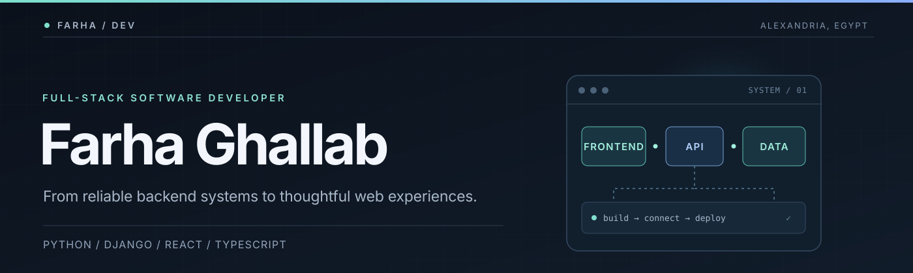

  

# Farha Ghallab

**FULL-STACK SOFTWARE DEVELOPER**

Building software that works — from backend systems to modern web experiences.

`Python` &nbsp; `Django` &nbsp; `React` &nbsp; `TypeScript` &nbsp; `PostgreSQL`

[Portfolio](https://farhaportofolio.vercel.app) &nbsp; / &nbsp;
[LinkedIn](https://eg.linkedin.com/in/farhaghallab) &nbsp; / &nbsp;
[Email](mailto:farhagalab74@gmail.com)

 

---

### 01 / ABOUT

I'm a Full-Stack Developer based in Alexandria, Egypt.

I build web applications end to end — designing APIs, working with databases, developing responsive interfaces, and deploying software.

My focus is on creating practical, maintainable products that solve real problems.

 

### 02 / SELECTED WORK

**01 — REAL ESTATE SALES CRM**

Full-stack platform for managing leads, properties, tasks, viewings, and sales workflows.

`React` `TypeScript` `Django REST Framework` `PostgreSQL`

[Explore repository](https://github.com/farhaghallab3/real-estate-sales-crm)

---

**02 — WEBSOCKET CONTROL PANEL**

Real-time monitoring interface with WebSocket lifecycle management, event filtering, and automated tests.

`React` `TypeScript` `WebSocket` `Vitest`

[Explore repository](https://github.com/farhaghallab3/WebSocket-Control-Panel)

---

**03 — FATOORA CONNECT**

Independent SaaS project focused on e-invoicing integrations and backend-driven workflows.

`API Architecture` `Background Processing` `Full-Stack Development`

Private project. Technical details available on request.

 

### 03 / TECHNOLOGIES

| Backend | Frontend | Infrastructure |
| :--- | :--- | :--- |
| Python | React | Docker |
| Django / DRF | Next.js | Linux |
| PostgreSQL | TypeScript | Nginx |
| REST APIs | Tailwind CSS | Git |

 

### 04 / CURRENT FOCUS

- Building full-stack SaaS products
- Backend architecture and API design
- Real-time systems and automated testing
- Deployment and production reliability

 

---

**LET'S BUILD SOMETHING USEFUL.**

Open to Full-Stack, Python/Django Backend, and React Frontend opportunities.

Alexandria, Egypt · Remote-friendly

[Portfolio](https://farhaportofolio.vercel.app) &nbsp; / &nbsp;
[LinkedIn](https://eg.linkedin.com/in/farhaghallab)

