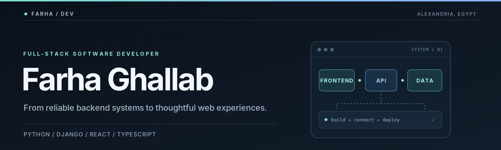

  

  <a href="https://farhaportofolio.vercel.app">Portfolio</a>
  &nbsp;&nbsp; / &nbsp;&nbsp;
  <a href="https://eg.linkedin.com/in/farhaghallab">LinkedIn</a>
  &nbsp;&nbsp; / &nbsp;&nbsp;
  <a href="mailto:farhagalab74@gmail.com">Email</a>

 

### 01 / ABOUT

I'm a Full-Stack Developer based in Alexandria, Egypt, building web applications from backend architecture to responsive frontend experiences.

My core stack is **Python, Django REST Framework, PostgreSQL, React, and TypeScript**.

I focus on developing practical, maintainable software — from designing APIs and database models to building interfaces and deploying applications.

 

### 02 / SELECTED WORK

**01 — REAL ESTATE SALES CRM**

A full-stack platform for managing real estate leads, properties, tasks, viewings, and sales workflows.

`React` `TypeScript` `Django REST Framework` `PostgreSQL`

[Explore repository](https://github.com/farhaghallab3/real-estate-sales-crm)

---

**02 — WEBSOCKET CONTROL PANEL**

A real-time monitoring application with WebSocket connection management, live event processing, filtering, and automated tests.

`React` `TypeScript` `WebSocket` `Vitest`

[Explore repository](https://github.com/farhaghallab3/WebSocket-Control-Panel)

---

**03 — FATOORA CONNECT**

An independently developed SaaS project focused on e-invoicing integrations and backend-driven workflows.

`API Architecture` `Background Processing` `Full-Stack Development`

*Private project — selected technical details available on request.*

 

### 03 / TECHNOLOGIES

| Backend | Frontend | Infrastructure |
| :--- | :--- | :--- |
| Python | React | Docker |
| Django / DRF | Next.js | Linux |
| PostgreSQL | TypeScript | Nginx |
| REST APIs | Tailwind CSS | Git |

 

### 04 / CURRENT FOCUS

- Full-stack SaaS development
- Backend architecture and REST API design
- Real-time systems and automated testing
- Deployment and production reliability

 

---

  <strong>LET'S BUILD SOMETHING USEFUL.</strong>

  Open to Full-Stack, Python/Django Backend, and React Frontend opportunities.

  Alexandria, Egypt · Open to remote opportunities

